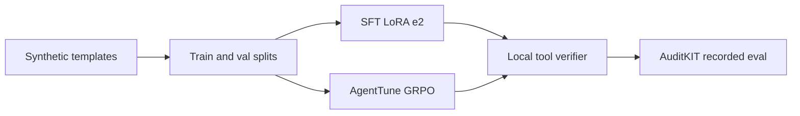

Paste this file over the existing article https://huggingface.co/blog/ArianMoridani/actproto-lora-verified-tool-use-on-tiny-aya-and-a. Do not open a second post.

The Hub pages that exist today: article URL above, dataset https://huggingface.co/datasets/ArianMoridani/LexsiHackathon (empty), Space https://huggingface.co/spaces/ArianMoridani/LexsiHackathon (default template), GitHub https://github.com/AriCommits/Pub_Hackathons. Model collection: TODO. Dataset collection: TODO.

# ActProto-LoRA: verified tool use on Tiny Aya by supervised LoRA

A LoRA adapter on Tiny Aya Global answers synthetic business questions by calling local tools, and a task counts only when the harness runs those calls. A prototype router and a GRPO trainer were built beside that adapter. They are reported here. They are not the selected policy.

## Content warning

None. The prompts are synthetic business questions. There is no harmful or NSFW text in this write-up.

## Tracks and problem statements

- Track 3, problem 1. Reliable tool calling. The verified policy is supervised LoRA on gold tool trajectories. Reinforcement learning on real tool rollouts was implemented and run, and it is not the improvement claim.
- Track 3, problem 6. Data and database agents. The questions are about a local fixture table, a record store, and a document catalog. The reward is the checked tool result.

Track 3 problem 2 (shorter trajectories at the same success rate) is not claimed. This checkout has no efficiency number for it.

## Abstract

ActProto-LoRA fine-tunes Cohere Labs Tiny Aya Global so a small local agent can answer business questions by calling tools, and so a task scores as correct only when those tools actually run. The selected model is a LoRA adapter, id e2, checkpoint-150, trained on synthetic English trajectories. Five deterministic tools cover the work: record lookup, a sales-table query, document search, a calculator, and finish. The harness checks the call against the tool schema and checks the final value. An assistant message that only says it is done does not pass.

Two other methods sit beside that adapter and do not replace it. A prototype router reads the residual stream just before the tool name is chosen and abstains unless a validation threshold is met. GRPO on in-process tool rollouts was built and run. Early runs scored every step at reward −0.1 because sampling happened while the model was in train mode. After generation was switched to eval mode, a short study finished episodes at reward 1.0. The groups were often tied, because the supervised adapter already solved many of the training prompts, so the policy did not move. That study is not a validation win.

Project notes record validation macro verified task success of 1.0 on all 200 validation tasks for the frozen adapter. The scored JSON is not in this checkout, and a stored improvement field of about 0.75 is not turned into a before-score here. The public data release is the training messages and the validation prompts. The sealed test, the stress split, oracles, fixtures, and traces stay private. The base weights are gated. The submitted artifact is the adapter.

Word count: 272

## Headline before and after

| | verified task success (macro, validation) |
| --- | --- |
| Before | unknown. `docs/SFT_BASELINE_MANIFEST.json` stores `improvement` = 0.7466666666666666 and does not define that subtraction. It is not inverted into a baseline score here. |
| After | 1.0 on 200/200 validation tasks, as written in `docs/plan_13/OVERVIEW.md` for `results/sft_v2/e2-scored`. That scored directory is not in this checkout, so this packet does not recompute the figure. |

The selected checkpoint is frozen SFT e2, `results/sft_v2/e2/checkpoint-150`, directory digest `6125195bc713f8c4d9e89070233b65667a8068f8fc684a1e14a2522a26b8d670`.

## Base model and method

`CohereLabs/tiny-aya-global` at revision `af89d219b53ed9b13b8a4645f9c8028973510324`, bf16 LoRA, not 4-bit, rank 16, trained on gold tool trajectories.

## For judges: one minute

The claim is verified tool use, not a model that says it used a tool. The metric is macro verified task success, and higher is better. Project notes record 1.0 on 200 validation tasks for frozen SFT e2, and the raw score file is not in this tree. GRPO looked broken at reward −0.1, then finished at reward 1.0 after a sampling fix, and still did not replace e2 because the groups were tied. Code is this `lexsi/` project. The public data slice is `submission/data/`. The base model is gated.

## Problem statement and approach

The agent has five tools: `lookup_record`, `query_database`, `search_docs`, `calculator`, and `finish`. `no_tool` is an alias of finish. Each turn is one JSON object, bare or wrapped in `<tool_call>…</tool_call>`. Extra prose, a second call in the same turn, or arguments that miss the schema end the episode as a parse failure. The tools are deterministic and local. There is no live web API.

Ordinary questions are scored on the outcome, so a valid alternative argument path can pass. Ordered tasks and recovery tasks check the declared call dependencies. Explicit no-tool tasks forbid every nonterminal tool. The gold trajectory is supervision for training. It is not, by itself, the definition of success at eval time.

The selected training method is supervised fine-tuning of a LoRA adapter on those gold trajectories. The prototype router is a second path: residual-stream activations at the last prompt token, before the tool name is sampled, compared with a cosine prototype per tool, and used only when the match clears a threshold fit on validation. Arguments are regenerated against the chosen tool's schema. The tool name inside an already written call is left alone. GRPO is a third path and is described under Method as a negative result.

## Why this problem

A small model that answers from a private table has to read the cell. If it invents the number, the answer is wrong even when the prose looks fluent. Verified tool use is the check that matches that use: run the query, then score the value. Tiny Aya is small enough to fine-tune on one 16 GB GPU, which is the setting this project actually had.

## Research questions

The working hypothesis, from `docs/METHOD.md`, is that the hidden state just before a tool call contains a linearly readable signal for which tool should run, and that mean prototypes plus a validation threshold can raise verified success or cut wasteful calls relative to ordinary LoRA. That hypothesis was not given a new number in this packet. The committed snapshot does not include a B2-versus-B1 table. No hypotheses were pre-registered in a public registry.

## Threat model

The agent can call only the local fixture tools. It cannot reach the network, and the documents it searches are the synthetic catalog built with the dataset. A wrong answer is a failed task, not a security finding. This is not a red-team or jailbreak study.

## Related work

The base model is described in Salamanca et al., Tiny Aya: Bridging Scale and Multilingual Depth, arXiv:2603.11510. The reinforcement-learning trainer is TRL's GRPO implementation, pinned in this project at TRL 1.7.1 next to AgentTune 1.1.3. The hackathon kits actually exercised are AgentTune and AuditKIT, linked below.

## Hackathon repos

### AgentTune

AgentTune 1.1.3, commit `d4db4c12d52342227c4113a70183d0f64aa2f345`, is the GRPO and multi-turn rollout stack in the CUDA environment. The trainer samples a tool action, executes it in process, and scores the episode. The selected submitted policy is the supervised adapter, not a GRPO checkpoint.

### AuditKIT

AuditKIT 1.1.3, commit `71316da345784ff220d5ed59337441a59ab31526`, is wired for recorded episodes: `AgentEvalRunner.run` with a custom predicate that rebuilds the local trace and calls the shared verifier. The 200/200 figure's score file is not in this checkout, so this write-up cannot show an AuditKIT verdict for it. The notes attribute that figure to the local validation runner. A compatibility shim is not described here as "AuditKIT produced the headline."

### CuratorKIT

Not used. The dataset is generated from templates. Nothing was filtered with CuratorKIT.

### AlignTune

Not used.

### SafeTune

Not used.

### CircuitKIT

Not used for any reported number. `docs/METHOD.md` allows an optional layer sweep that writes `actproto/configs/layer.yaml` and must not rewrite `model.yaml`. No committed result says that sweep changed a score.

## How the repos connect

Templates and a fixture environment become the train, validation, and sealed splits. Supervised LoRA trains on the public training messages and produces e2. Validation runs the tools and scores the result. AgentTune is the path that tried to keep training with GRPO on those same tools. AuditKIT is the recorded-eval path beside the local verifier. GRPO did not replace e2.



## Models and licenses

The base model is `CohereLabs/tiny-aya-global`, revision `af89d219b53ed9b13b8a4645f9c8028973510324`, bf16, 4-bit off. The model card states the license as CC-BY-NC and also requires Cohere Labs' Acceptable Use Policy. The repository is gated. This project does not ungate it and does not republish the base weights.

The submitted weights are the e2 LoRA adapter. Its directory digest is `6125195bc713f8c4d9e89070233b65667a8068f8fc684a1e14a2522a26b8d670`. The Git LFS oid of `adapter_model.safetensors` is `2da2899c0fd2f5ca0bffc32c2e9201e0b7bab8b1758d2fde429ff19cf50be8bd`. Those are different hashes of different objects. There is no teacher model and no closed-model baseline in the notes.

The config asked for two epochs. The frozen manifest records one epoch executed.

## Datasets, benchmarks, and licenses

The full contract is in `DATACARD.md`. Short version: synthetic English templates, seed 42, 1,200 train / 200 validation / 200 new-entity test / 200 stress. Stress is a held-out template family, not a held-out language. Leak checks cover group, entity, exact prompt, normalized prompt, and call fingerprint.

The public slice in `submission/data/` has the 1,200 training messages and the 200 validation prompts. Test, stress, oracles, fixtures, and traces are withheld. The slice is licensed CC-BY-NC-4.0. The rows are generator output, not samples from Tiny Aya.

No CuratorKIT filtering was applied. There is no attack-prompt set and no over-refusal set. Those belong to other tracks.

The tool environment is `tooluse_v2.fixtures.1`: records, a sales table, and a document catalog, plus the calculator and finish.

## Metrics, and why these

Verified task success is the headline. Higher is better. The harness runs the tools and checks the answer, so a fluent false answer does not pass. Project notes record that macro at 1.0 on the 200 validation tasks.

Tool-call validity, unnecessary calls, and latency are part of the evaluation design in `docs/METHOD.md`. Their numbers are not in this checkout, so they are not listed as results. An LLM judge was not used. The checker is the deterministic tool result.

## Method

### Supervised LoRA

From `actproto/configs/sft_v2.yaml` and `actproto/training/sft_v2.py`: rank 16, alpha 32, dropout 0.05, learning rate `2e-4`, batch size 1, gradient accumulation 8, seed 42, max length 8192, bf16. Target modules are `q_proj`, `k_proj`, `v_proj`, `o_proj`, `gate_proj`, `up_proj`, `down_proj`. The frozen run executed one epoch. The manifest lists experiments `e1` and `e3` as omitted. This packet has no ablation table for them.

### GRPO, not the selected policy

From `actproto/configs/grpo_v2_gpu_prefix.yaml` and `docs/RESULTS_2026-11-14.md`: beta 0, learning rate `5e-6`, two generations, temperature 0.8, top_p 0.95, 256 new tokens per turn, bf16, vLLM off, seed 42. The study device is an RTX 5060 Ti.

A 20-step study logged reward −0.1 on every step, zero advantage, and `template_mismatch` 42 times. Sampling ran under `model.train()` with gradient checkpointing, and the completions were truncated garbage. The adapter did not change. After `_sample_peft_action` forces `eval()` for `generate`, an 8-step study logged `finish` 18 times and reward 1.0 18 times. Groups were often tied at 1.0, which gives advantage 0, so the LoRA does not have to move. That is a repaired trainer, not a better validation score.

## Results

| System | Validation macro verified success | Notes |
| --- | --- | --- |
| Before e2 | unknown | Improvement field is stored and not converted into this cell. |
| Frozen SFT e2 | 1.0 on 200/200, from project notes | Raw `results/sft_v2/e2-scored` is absent here. |
| GRPO study, pre-fix | not a val score | Train reward −0.1, adapter unchanged. |
| GRPO study, post-fix | not a val score | Train reward 1.0, groups often tied. |

### What didn't work

The pre-fix GRPO run did not train. The constant −0.1 reward was a sampling bug, not a hard tool-use failure. The post-fix run did finish tool episodes, and the tied rewards meant the update was often skipped. Increasing the group size does not fix a group whose rewards are identical. The prototype-versus-plain-LoRA comparison is a hypothesis in `docs/METHOD.md` and does not have a number in this checkout.

### Sample turn

This is a schema illustration, not a test item.

```text
user: How many sales were recorded for item2000001 in 2020? Return only the requested value as the final answer.
assistant: <tool_call>{"name": "query_database", "arguments": {"product": "item2000001", "year": 2020}}</tool_call>
tool: {"ok": true, "data": {"rows": [{"sales": 1234}], "count": 1}}
assistant: <tool_call>{"name": "finish", "arguments": {"answer": "1234"}}</tool_call>
```

## Limitations

The training and reference text is English only. The base model covers many languages, and this adapter was not trained or scored as a multilingual system. The entities are synthetic. The sealed test is not reported. The base weights are gated. GRPO groups tied, so that stack did not produce a new policy. GPU hours and dollar cost were not logged. The before-score is unknown. Tool-call F1, unnecessary-call rate, and latency were not in the scored file that this checkout has.

Also skipped, because the notes do not contain them: confidence intervals, a significance test, agreement with a human judge, a cost-per-1,000-replies comparison, and a safety-benchmark retention check.

## With more credits

The next measurement is a GRPO run whose rewards are not tied, on the same verifier, scored on the validation split against frozen e2. A second measurement is the efficiency cut in Track 3 problem 2: fewer calls at the same verified success. A third is publishing the adapter under the CC-BY-NC terms once a human confirms what may be redistributed beside the weights.

Expected direction, without a fake score: a run with untied rewards can move the adapter, and it might not raise validation success if e2 is already at the recorded 1.0 on that split. An efficiency run would be worth doing only if unnecessary-call counts are logged. This packet does not forecast a number.

## Artifacts

- Write-up: this file, and the Hugging Face article at https://huggingface.co/blog/ArianMoridani/actproto-lora-verified-tool-use-on-tiny-aya-and-a
- Dataset repo, still empty on the Hub: https://huggingface.co/datasets/ArianMoridani/LexsiHackathon
- Local public slice: `submission/data/`
- Space, still the default template on the Hub: https://huggingface.co/spaces/ArianMoridani/LexsiHackathon
- Local Space bundle: `submission/space/`
- GitHub: https://github.com/AriCommits/Pub_Hackathons
- Hugging Face model collection: TODO
- Hugging Face dataset collection: TODO

## Documentation and reproduction

See `REPRODUCE.md` for the environment, the folder layout, and the commands. The sealed test is not part of the public reproduce path.

## Declaration of work done outside the hackathon

No pre-hackathon paper is claimed. The code, notes, and this write-up are the hackathon project. An earlier checklist in `docs/SUBMISSION.md` named 14 November 2026. This packet was assembled after that date from the same project.

## What we learned

A constant negative reward can be a trainer bug. Here it was sampling in train mode. After that bug was fixed, the same runs showed a different limit: if the supervised model already solves the prompts, a group of successes has advantage zero and GRPO does not move. Verified success and a training reward are not the same claim.

## Teammates

None are named in the repository.

## Author contributions

Arian Moridani: the project. The Hugging Face article byline is the source for that name.

## Acknowledgements

None recorded in the repo beyond the Tiny Aya release and the hackathon kits.

## References

- Salamanca et al., Tiny Aya: Bridging Scale and Multilingual Depth, https://arxiv.org/abs/2603.11510
- Model card, https://huggingface.co/CohereLabs/tiny-aya-global
- AgentTune and AuditKIT as used at the commits named above
- TRL GRPO, the 1.7.1 pin in `docs/RL_GPU_ENV.md`

## LLM usage statement

An agent drafted this write-up from `submission/FACTS.md` and the repo notes. The numbers were copied from those files, not recomputed, except the public data-slice hashes, which the curator wrote while building `submission/data/`.
